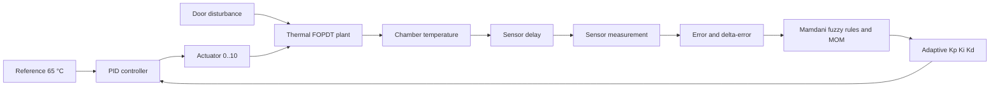
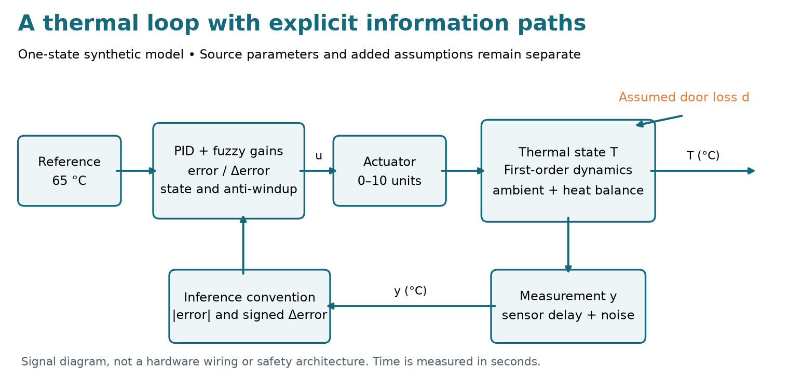
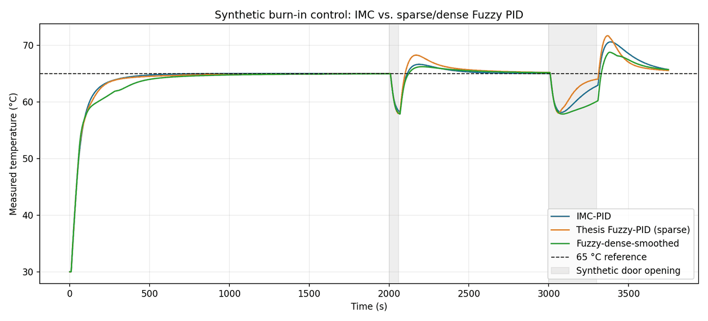

# ThermoFuzzy-PID

**Adaptive Fuzzy-PID Thermal Control for Burn-In Chambers**

<p>
  
  
  
  
  
  <a href="LICENSE"></a>
</p>

**ThermoFuzzy-PID** is a reproducible, notebook-centered research framework for **adaptive Fuzzy-PID thermal control in electronic-device burn-in chambers**. It builds on a 2021 undergraduate thesis and includes a traceable Mamdani fuzzy rule base, **Internal Model Control (IMC)** PID tuning, **Python and MATLAB** implementations, a **Simulink model generator**, synthetic four-sensor datasets, automated tests, robustness benchmarks, and experimental optimization workflows.

**Scope:** Source-reported parameters are carefully separated from synthetic measurements and new numerical assumptions. Proposed enhancements remain exploratory and are **not** validated for physical hardware or industrial burn-in qualification.

> **Scientific integrity:** The original PDF and measured temperature time series are **not distributed in this repository**. The 2021 thesis reports ~22% faster temperature rise and ~3% faster door-disturbance response under its original conditions; this repository **does not claim to reproduce** those results. Every generated dataset is explicitly labeled **synthetic**. MATLAB and Simulink source is provided but has not been runtime-tested here because MATLAB was unavailable.

## Academic context

> **Foundational research:** Matheus Gomes Cordeiro. *Projeto de um Controlador PID-Fuzzy para a Câmara de Burn-in* [*Design of a Fuzzy-PID Controller for a Burn-In Chamber*]. Undergraduate thesis, Computer Engineering, Universidade Federal do Ceará (Federal University of Ceará, UFC), Fortaleza, Brazil, **2021**. Approved on **10 September 2021**.
>
> **Author / maintainer:** [Matheus Gomes Cordeiro](https://github.com/fobos123deimos)
>
> **Thesis advisor:** **Prof. Dr. José Tarcísio Costa Filho** — [Lattes CV (link provided by UFC)](https://buscatextual.cnpq.br/buscatextual/visualizacv.do?id=K4785436Z5&metodo=apresentar) · [UFC faculty directory](https://deti.ufc.br/pt/corpo-docente/professores-efetivos/)

## Navigation

- [Illustrated Python API (pdoc)](https://fobos123deimos.github.io/thermofuzzy-pid/) · [Versioned HTML](docs/api/index.html) · [Build and maintenance](docs/API_DOCUMENTATION.md)
- [Project goals](#project-goals)
- [Google Colab notebooks](#google-colab-notebooks)
- [Theoretical source review](#theoretical-source-review)
- [Physical model](#physical-model)
- [PID and IMC tuning](#pid-and-imc-tuning)
- [Adaptive Mamdani fuzzy gains](#adaptive-mamdani-fuzzy-gains)
- [Reproducibility and data provenance](#reproducibility-and-data-provenance)
- [Results of the included synthetic benchmark](#results-of-the-included-synthetic-benchmark)
- [Run in Python](#run-in-python)
- [Run in MATLAB and Simulink](#run-in-matlab-and-simulink)
- [Repository layout](#repository-layout)
- [Research directions and limitations](#research-directions-and-limitations)
- [References](#references)
- [Citing this software](#citing-this-software)

## Project goals

1. **Traceable implementation:** transcribe the thesis's identified FOPDT parameters, 7 × 7 sparse rule table and normalized gain ranges.
2. **Reproducible evaluation:** run matched, deterministic closed-loop scenarios with IMC-PID, sparse PID-Fuzzy and a new dense/smoothed variant.
3. **Python + MATLAB:** provide independent implementations and documented input/output conventions.
4. **Simulink:** generate `.slx` closed-loop models programmatically (requires local MATLAB/Simulink).
5. **Research extensions:** interpolate deliberately omitted rules, smooth gains, use derivative filtering/anti-windup, test uncertainty and tune hybrid fuzzy/IMC gains.
6. **Theory-based extensions:** identify a constrained ARX model, compare conditional vs. back-calculation anti-windup, and estimate frequency-domain robustness of *fixed* linear PID loops.



## Google Colab notebooks

Each `.ipynb` includes mathematical Markdown, runnable Python, plots and its own **Open in Colab** badge. Colab installs the Python package from this repository on first run.

| Notebook | Main workflow | Colab |
|---|---|---|
| [01 — Thermal modeling and identification](notebooks/01_thermal_model_identification.ipynb) | FOPDT transfer function, deterministic four-sensor synthetic data, least-squares identification and validation plot | [](https://colab.research.google.com/github/fobos123deimos/thermofuzzy-pid/blob/main/notebooks/01_thermal_model_identification.ipynb) |
| [02 — Fuzzy rules and benchmark](notebooks/02_fuzzy_pid_and_benchmark.ipynb) | Mamdani M-o-M inference, sparse/dense rule surfaces, PI(D)/IMC comparison and metrics | [](https://colab.research.google.com/github/fobos123deimos/thermofuzzy-pid/blob/main/notebooks/02_fuzzy_pid_and_benchmark.ipynb) |
| [03 — Uncertainty and robustness](notebooks/03_uncertainty_and_robustness.ipynb) | Paired Monte Carlo tests under uncertain gains, time constants, delays, noise and disturbances | [](https://colab.research.google.com/github/fobos123deimos/thermofuzzy-pid/blob/main/notebooks/03_uncertainty_and_robustness.ipynb) |
| [04 — Fuzzy optimization](notebooks/04_fuzzy_optimization.ipynb) | Differential evolution of smoothing/mixing factors, held-out synthetic evaluation and ablation | [](https://colab.research.google.com/github/fobos123deimos/thermofuzzy-pid/blob/main/notebooks/04_fuzzy_optimization.ipynb) |
| [05 — Theory: ARX, anti-windup, robustness](notebooks/05_theory_arx_antiwindup_robustness.ipynb) | Source-grounded ARX least squares, back-calculation vs. conditional integration, and $M_s$/gain/phase margins for **fixed linear** PID | [](https://colab.research.google.com/github/fobos123deimos/thermofuzzy-pid/blob/main/notebooks/05_theory_arx_antiwindup_robustness.ipynb) |

## Theoretical source review

In addition to the 2021 thesis, the theoretical background was **audited against the author's connected research materials**: two preliminary PI/PID reports, ARX/system-identification lecture notes, an editable copy of the sparse fuzzy rule matrix, and a thermal-reliability dissertation found in Google Drive; plus the **PET Engenharia Elétrica UFC MATLAB 8.1 guide** and a numerical-methods course found in Dropbox. **None of those private PDFs, documents, or source contents has been uploaded to GitHub.**

The audit led to three **separate, tested research/teaching extensions**, with their assumptions documented:

- **ARX identification:** a constrained first-order, known integer-input-delay least-squares fit, plus $\tau=-\Delta t/\ln(a)$ and $K=b/(1-a)$. It is *not* a re-creation of the historical System Identification Toolbox run.
- **Anti-windup:** the original Drive report describes back-calculation; our existing Python default was conditional integration. Both are now selectable; the numerical tracking time $T_t$ is a new assumption.
- **Frequency-domain robustness:** numerical gain/phase margins and maximum sensitivity $M_s=\max_{\omega\in\Omega}|1/(1+L(j\omega))|$ for **fixed, unsaturated linear** controllers. These are not stability guarantees for adaptive fuzzy PID.

See [**Theoretical foundations and equations**](docs/theoretical_foundations.md), [**source-by-source audit**](docs/source_audit.md), and [**source traceability**](docs/source_traceability.md), or run [notebook 05](notebooks/05_theory_arx_antiwindup_robustness.ipynb). The final thesis remains the primary authority for its reported parameters and outcomes; earlier drafts have some conflicting numbers and are **not silently used to overwrite the thesis**.

## Physical model



The diagram separates the physical-temperature state from its delayed, noisy measurement. Door cooling enters as an assumed input-equivalent disturbance; it is not a calibrated heat-loss channel. The [illustrated API reference](docs/API_DOCUMENTATION.md) connects each signal to the corresponding Python implementation.

### First-order plus dead time (FOPDT)

The thesis models the **combined heating/sensor response** in Laplace coordinates as

$$
\boxed{G(s)H(s) = \frac{\bar K e^{-\theta s}}{\bar\tau s + 1}} \tag{1}
$$

where $\bar K$ is process/sensor steady-state gain, $\bar\tau$ (s) is the time constant, and $\theta$ (s) is effective dead time. The nominal **mean of measured temperatures** model reported in Section 3.1 is:

$$\boxed{\bar K=7.624,\qquad\bar\tau=151.6\,\mathrm{s},\qquad\theta=8.78\,\mathrm{s}.}\tag{2}$$

| Identified case in the thesis | Gain $K$ | Time constant $\tau$ (s) | Dead time $\theta$ (s) |
|---|---:|---:|---:|
| TH37 sensor | 8.7135 | 326.18 | 13.677 |
| TH34 sensor | 7.7473 | 177.95 | 13.064 |
| Mean of TH22/TH37/TH40/TH34 measured temperatures | **7.624** | **151.6** | **8.78** |
| Mean of independently estimated model parameters | 8.028 | 186.5 | 12.5 |

For a *synthetic* scalar plant state $T(t)$, we model equivalent heater input $u$ and door heat loss $d$ through

$$\boxed{\tau \frac{dT}{dt}=-(T-T_a)+K\,[u(t)+d(t)]} \tag{3}$$

and the sensor reads $y(t)=T(t-\theta)+\eta(t)$, with additive noise $\eta$. This is a **modeling choice** that allocates the effective dead time to the sensor. The original thesis does not uniquely identify this physical allocation or an independent door-transfer function. $T_a=30$ °C, $u\in[0,10]$ in *effective heater units*, and the door amplitudes are illustrative assumptions. Neither the units of $K$ nor the thermal safety bounds should be interpreted as a validated actuator calibration.

Exact zero-order-hold integration of Eq. (3), assuming constant effective input over $\Delta t$, gives

$$
T_{k+1}=T_a+e^{-\Delta t/\tau}(T_k-T_a)+K(1-e^{-\Delta t/\tau})(u_k+d_k). \tag{4}
$$

For a unit step with ambient initial condition, the transfer-function step response is

$$T_{\mathrm{sensor}}(t)=T_a+K\left[1-e^{-(t-\theta)_+/\tau}\right],\quad(x)_+=\max(0,x).\tag{5}$$

## PID and IMC tuning

The parallel/independent PID implemented in Python and MATLAB is

$$
\boxed{u_{\rm raw}(t)=K_p(t)e(t)+\int_0^t K_i(\xi)e(\xi)\,d\xi-K_d(t)\frac{d y_f(t)}{dt}},\quad e(t)=r(t)-y(t).\tag{6}
$$

For time-varying $K_i$, the discrete implementation uses the current $K_i[k]$ in each integration increment, rather than multiplying the entire accumulated error by a varying $K_i$. Derivative action is **on measurement**, low-pass filtered, to prevent derivative kick and reduce noise amplification. Output saturation offers **two selectable anti-windup strategies**: conditional integration (the backward-compatible default) and back-calculation (an independently implemented option motivated by the earlier PI/PID engineering report). The tracking time for back-calculation is not provided by the historical source. See [theory documentation](docs/theoretical_foundations.md).

The original thesis provides the following IMC-PID tuning rules:

$$\begin{aligned}
K_p &= \frac{\tau+\theta/2}{K(\lambda+\theta)},\\
T_i &= \tau+\theta/2,\\
T_d &= \frac{\tau\theta}{2\tau+\theta}.
\end{aligned}\tag{7}$$

The ISA-to-parallel conversion is $K_i=K_p/T_i$ and $K_d=K_pT_d$. At $\lambda=35.3273$ s, Eq. (7) yields approximately $K_p=0.464$, $T_i=155.99$ s, $T_d=4.267$ s, consistent with the source's rounded values $0.4640$, $156.0254$, and $4.2655$.

> **Notation caveat:** The source manuscript uses $K_i$, $T_i$ and $K_d$, $T_d$ in a few different conventions. This repository consistently uses **independent gains** $(K_p,K_i,K_d)$ in the code and explicitly converts IMC/ISA parameters before simulation. See [Technical notes](docs/source_traceability.md).

## Adaptive Mamdani fuzzy gains

### Inputs, membership functions and inference

The thesis builds a fuzzy inference system around error and error variation (Sec. 3.3; Fig. 14). The code resolves a source ambiguity by using $|e|\in[0,40]$ °C (the stated nonnegative domain) and signed $\Delta e=e_k-e_{k-1}\in[-40,40]$ °C. Each input has **7** linguistic terms (`NB`, `NM`, `NS`, `Z`, `PS`, `PM`, `PB`), with **2 endpoint shoulders** and **5 triangular** interior MFs. Each output uses **5 triangular** categories (`S`, `MS`, `M`, `MB`, `B`) on $[0,1]$.

For a rule $j$ and output coordinate $z$:

$$w_j=\min\!\big(\mu_{A_j}(|e|),\mu_{B_j}(\Delta e)\big),\qquad
\mu_{\rm agg}(z)=\max_j \min(w_j,\mu_{C_j}(z)).\tag{8}$$

Defuzzification uses **Mean of Maxima (M-o-M)** on a documented 201-point grid, rather than the centroid:

$$\boxed{z^*=\frac{1}{|\mathcal M|}\sum_{z\in\mathcal M}z,\quad
\mathcal M=\arg\max_{z\in\{0,0.005,\ldots,1\}}\mu_{\rm agg}(z)}.\tag{9}$$

Finally, Eq. 2.14 of the thesis maps each normalized fuzzy output to an independent PID gain:

$$\boxed{K_j=K_{j,\min}+(K_{j,\max}-K_{j,\min})\,K'_j,\quad j\in\{p,i,d\}}.\tag{10}$$

| Gain | Minimum | Maximum |
|---|---:|---:|
| $K_p$ | 0.35 | 0.90 |
| $K_i$ | 0.0008 | 0.045 |
| $K_d$ | 0 | 2.0 |

### Missing rules and newly proposed extensions

The source's **Figure 15** has 7 delta-error rows × 7 error columns; it deliberately leaves the entire **NM** and **PM** error columns unspecified and some individual gain consequents unspecified. These omissions are represented precisely in `src/burnin_pid_fuzzy/fuzzy.py` and `matlab/fuzzy_rule_matrix.m`.

- **Sparse (source-derived):** omitted input combinations do not fire; unspecified output gains retain their previous values. This retention policy is a minimal implementation of the paper's stated behavior; an initialization of $0.5$ is an **assumption**.
- **Dense (new experiment):** interpolate missing consequents across neighboring error categories and round to the nearest linguistic label. This creates a complete candidate rule table, **not** a claim about the original 2021 controller.
- **Gain smoothing (new):** $\mathbf K'_k\gets(1-\gamma)\mathbf K'_{k-1}+\gamma\mathbf K'_{\rm MOM,k}$ to reduce rapid gain variation.
- **Hybrid gain blending (new, Python):** $\mathbf K_k^{\rm hybrid}=\beta\mathbf K_k^{\rm fuzzy}+(1-\beta)\mathbf K^{\rm IMC}$; optimized **only using training simulations** in notebook 04.
- **Filtered derivative, actuator limits, conditional anti-windup (new implementations):** make controlled assumptions explicit and guard against unbounded actuator requests.

These are *testable hypotheses*, not guaranteed performance improvements.

## Reproducibility and data provenance

| Item | Provenance | Where |
|---|---|---|
| $K,\tau,\theta$ for TH37, TH34 and two averages | Reported in the 2021 undergraduate thesis, Section 3.1 | `models.py`, `thesis_parameters.m` |
| Sparse rule consequents | Transcribed from Figure 15 of the thesis; verified against rendered page | `fuzzy.py`, `fuzzy_rule_matrix.m` |
| Fuzzy gain bounds | Reported in Table 4 of the thesis | `controllers.py` |
| 65 °C target; door events near 2000 and 3000 s | Reported in Section 3.4 of the thesis | Scenario defaults |
| Ambient, actuator scale, door amplitudes, white-noise magnitude | **Assumed**, not measured | `Scenario` and `provenance.json` |
| TH22 and TH40 individual FOPDT values | **Synthetic assumptions** | `scripts/generate_data.py` |
| Raw time series, original Simulink files, experimental cross-validation | **Not available** | Not represented as real measurements |

The provided CSV has deterministic noise seed **2021**. The generated benchmark uses a 3750 s simulation, 1-second sample period, and two **assumed** door disturbances: −5 effective heater units from 2000–2060 s and from 3000–3300 s. Different physical actuator ranges or disturbance channels change the ranking.

## Results of the included synthetic benchmark



The CSV `data/synthetic/benchmark_metrics.csv` is regenerated by the benchmark script. The following are **computed only for the declared synthetic assumptions** and should not be compared numerically with the original undergraduate thesis's timing percentages:

| Controller | 10–90% rise (s) | Time to 60 °C (s) | IAE (°C·s) | Recovery after 2nd door (s) |
|---|---:|---:|---:|---:|
| IMC-PID | 135.9 | 123.6 | 6053.6 | 291 |
| Thesis Fuzzy-PID (sparse) | 152.0 | 136.7 | 6213.7 | 201 |
| Fuzzy dense + smoothed | 245.1 | 174.8 | 7114.7 | 231 |

**Interpretation:** under this particular synthetic actuator and disturbance setup, IMC produces lower total absolute error; the sparse fuzzy rules recover faster after the second synthetic disturbance. Completing the table **did not improve tracking** in this initial comparison. That is a useful negative result, supporting further tuning and ablation instead of promotional performance claims. See [Experimental protocol](docs/experimental_protocol.md).

## Run in Python

```bash
# Python 3.10+
git clone https://github.com/fobos123deimos/thermofuzzy-pid.git thermofuzzy-pid
cd thermofuzzy-pid
python -m pip install -e '.[notebook,test]'
python -m pytest -q
python scripts/generate_data.py
python scripts/run_benchmark.py
jupyter lab
```

No GPU is required. Unit tests verify membership partitions, source-derived rules, M-o-M output bounds, IMC-to-ISA conversion, simulation determinism, bounded actuator control, ARX recovery for a known delay, and the two anti-windup strategies. GitHub Actions runs the tests for Python 3.10 and 3.12 after the project is pushed.

## Run in MATLAB and Simulink

Standalone MATLAB simulations use **MATLAB** without a fuzzy-specific toolbox. The separate frequency-domain analysis requires **Control System Toolbox**:

```matlab
cd('matlab');
run_experiments;
```

Fixed linear frequency-domain analysis requires the MATLAB **Control System Toolbox**:

```matlab
cd('matlab');
metrics = assess_fixed_pid_robustness();   % gain margin, phase margin and Ms
% First-order ARX identification is also available: fit_first_order_arx(u,T,dt,m,Tambient)
```

To **generate the Simulink `.slx` models from source**:

```matlab
cd('simulink');
build_burnin_simulink;
open_system('burnin_fuzzy_dense.slx');
sim('burnin_fuzzy_dense');
```

The generator creates `burnin_imc.slx` and `burnin_fuzzy_dense.slx` with explicit thermal dynamics, sensor delay, a MATLAB Function PID controller, door-profile input and workspace outputs. Requires Simulink and the MATLAB Function block/Stateflow interface. The binary `.slx` files are **generated on the user's licensed MATLAB installation**; the generator and embedded controller code are versioned. They have **not** been executed/validated in this environment. Refer to [Simulink instructions](simulink/README.md).

## Repository layout

```text
thermofuzzy-pid/
├── .github/workflows/tests.yml        # GitHub Actions CI
├── README.md                          # Source, math, runs, provenance
├── CITATION.cff                       # Citation metadata for research use
├── LICENSE                            # BSD-3-Clause
├── pyproject.toml                     # Installable scientific Python package
├── src/burnin_pid_fuzzy/
│   ├── fuzzy.py                       # Exact sparse + new dense Mamdani scheduler
│   ├── controllers.py                 # IMC, fuzzy, conditional/back-calculation anti-windup
│   ├── identification.py              # First-order ARX least-squares teaching model
│   ├── robustness.py                  # Fixed linear feedback frequency analysis
│   ├── models.py                      # Sensor-delay FOPDT and door scenarios
│   └── metrics.py                     # IAE, time-to-60, rise and recovery
├── notebooks/
│   ├── 01_thermal_model_identification.ipynb
│   ├── 02_fuzzy_pid_and_benchmark.ipynb
│   ├── 03_uncertainty_and_robustness.ipynb
│   ├── 04_fuzzy_optimization.ipynb
│   └── 05_theory_arx_antiwindup_robustness.ipynb
├── matlab/                            # Standalone .m implementation and loop margins
├── simulink/                          # MATLAB script generates .slx models
├── scripts/                           # Recreate notebooks, CSV and plots
├── data/synthetic/                    # Only explicitly synthetic data/results
├── docs/                              # Traceability, theoretical review and source audit
├── images/                            # Generated experiment plot
└── tests/                             # Python unit tests
```

## Research directions and limitations

The undergraduate thesis suggests extending the fuzzy inputs to the **second derivative of error**, refining the rule base and comparing intelligent optimizers. Good next experiments include: a three-input rule system, constraints on rule smoothness, GA/PSO/evolutionary optimization with fair time budgets, sensor fusion across all four positions, realistic time-varying heat losses, actuator power measurements and held-out real chamber datasets.

**Important:** The thermal plant is **single-zone** and not sufficient for operator safety or production burn-in validation. Running the controllers on physical equipment requires independent safety supervision, certified heater interlocks, sensor redundancy and thermal operating limits. No claims about energy savings, reliability qualification or guaranteed stability are made.

## References

1. Cordeiro, M. G. (2021). *Projeto de um Controlador PID-Fuzzy para a Câmara de Burn-in* [*Design of a Fuzzy-PID Controller for a Burn-In Chamber*]. Undergraduate thesis, Universidade Federal do Ceará. **Source consulted privately; the PDF is intentionally not hosted here.**
2. Ogata, K. (2011). *Engenharia de controle moderno* [*Modern Control Engineering*]. Pearson.
3. Simões, M. G., & Shaw, I. S. (2007). *Controle e modelagem fuzzy* [*Fuzzy Control and Modeling*]. Edgard Blücher.
4. Shahrokhi, M., & Zomorrodi, A. R. (2012). *Comparison of PID Controller Tuning Methods* (cited in the source undergraduate thesis).
5. MathWorks. [Programmatically editing Simulink models](https://www.mathworks.com/help/simulink/programmatic-modeling.html); [MATLAB Function block API](https://www.mathworks.com/help/simulink/slref/stateflow.emchart.html).
6. De Luca, L. V. (2004). *Recomendações para a Implementação de Ensaios de Estresse Térmico Voltados à Confiabilidade de Hardwares Eletrônicos*. Master's dissertation, Universidade Federal de Santa Catarina (UFSC). A copy was reviewed privately in the researcher's Drive; it is not redistributed.
7. PET Engenharia Elétrica, UFC (2014). *Apostila de MATLAB 8.1*, chapters 14–15. Reviewed in a private Dropbox technical archive; not redistributed.
8. Research notes reviewed privately: *Relatório Parcial 1 — Controle de Temperatura Média em Câmara de Burn-in* and *Relatório Parcial 2 — Implementação de Algoritmos PI e PID em CLP*. Earlier draft sources; see [audit](docs/source_audit.md) for limits.
9. UFC, Department of Teleinformatics Engineering. [Official faculty directory and advisor Lattes link](https://deti.ufc.br/pt/corpo-docente/professores-efetivos/).

## Citing this software

Use the repository's [citation metadata](CITATION.cff) when referencing the **ThermoFuzzy-PID** software. Cite the 2021 undergraduate thesis separately when discussing its reported model parameters, fuzzy rules, or historical experimental results. Software extensions, synthetic experiments, and preliminary performance figures should **not** be attributed to the original thesis.

## License

Released under [BSD 3-Clause](LICENSE). Based on academic research and new, clearly distinguished, open computational extensions.
