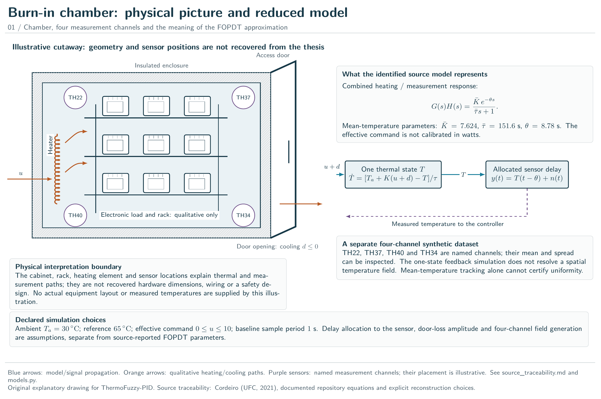
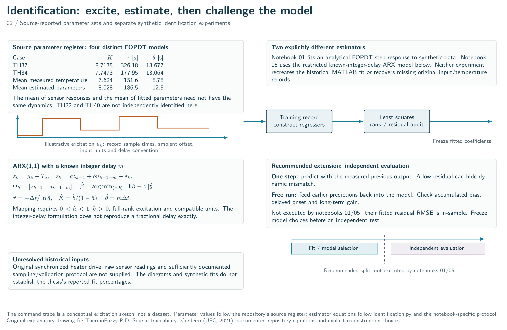
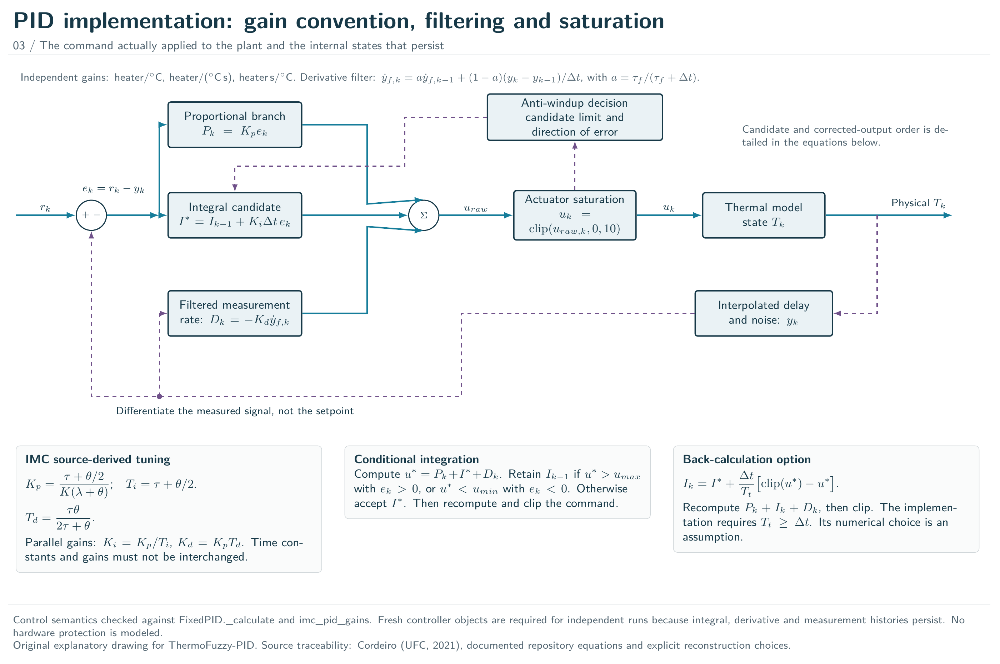
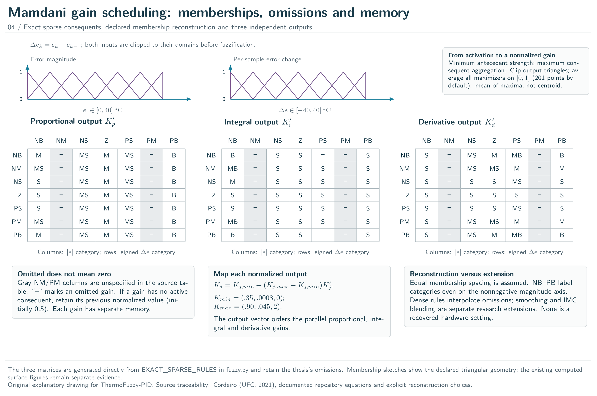
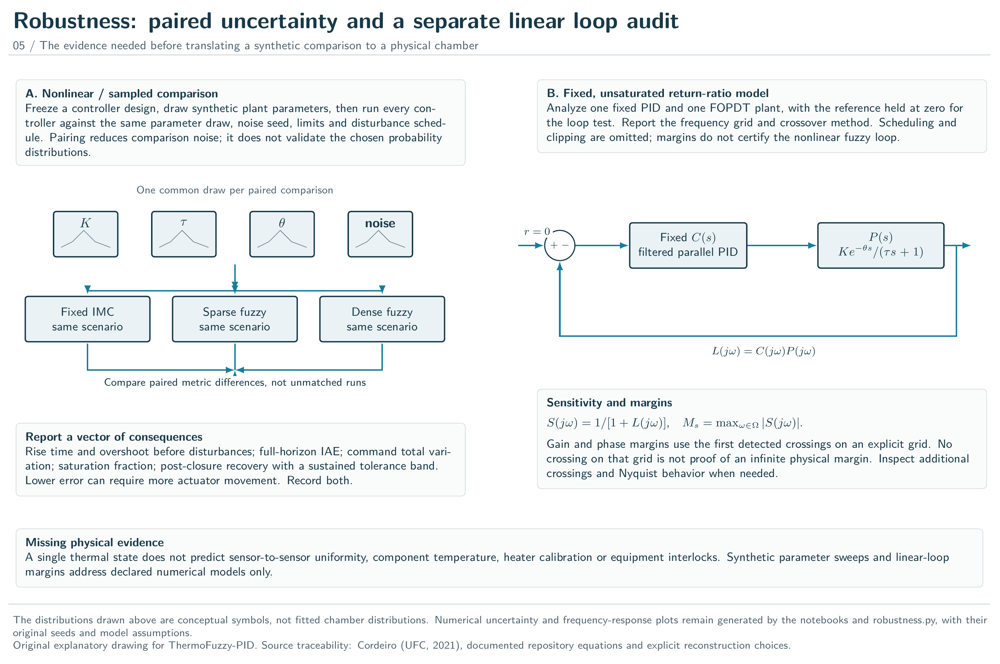
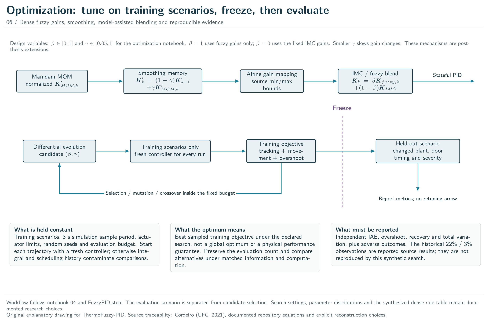

# Detailed thermal-control atlas

Six original TikZ plates connect the chamber picture, mathematical model, implemented control paths and experimental evidence. The cabinet geometry and sensor positions are illustrative. The original thesis, private source files and measured time series are not redistributed.

[Complete vector atlas](figures/tikz/thermal-control-atlas.pdf) · [Editable TikZ sources](tikz/) · [Source and artifact verification](figures/tikz/build.json)

The existing model-response, membership-surface and fixed-loop plots are retained as computed figures. The new plates explain their model boundaries and evaluation protocols; they do not introduce new performance measurements.

| Plate | Meaning |
|---|---|
| [Burn-in chamber: physical picture and reduced model](figures/tikz/01-chamber-model.pdf) | Illustrative cabinet, rack, heater and four named sensor channels, alongside the one-state model and allocated measurement delay. Geometry and sensor positions are not recovered hardware dimensions. |
| [Identification: excite, estimate, then challenge the model](figures/tikz/02-identification.pdf) | The four source-reported FOPDT parameter sets, synthetic in-sample fitting and a recommended independent validation path. The integer-delay ARX mapping is distinguished from the FOPDT step-fit experiment; notebooks 01/05 do not execute the recommended split. |
| [PID implementation: gain convention, filtering and saturation](figures/tikz/03-pid-imc.pdf) | Parallel PID branches, derivative on measurement, actuator limits and the exact candidate/corrected-integral distinction in conditional integration and back-calculation. |
| [Mamdani gain scheduling: memberships, omissions and memory](figures/tikz/04-fuzzy-inference.pdf) | Three 7-by-7 sparse consequent matrices read directly from the implementation, declared input memberships, mean-of-maxima inference and separate gain memory for omitted consequents. |
| [Robustness: paired uncertainty and a separate linear loop audit](figures/tikz/05-robustness.pdf) | Matched synthetic uncertainty experiments and a separate fixed, linear, unsaturated sensitivity/margin analysis. The two evidence domains are not interchangeable. |
| [Optimization: tune on training scenarios, freeze, then evaluate](figures/tikz/06-optimization-validation.pdf) | Dense-rule extensions, gain smoothing, IMC blending and a training-only differential-evolution loop with an explicit frozen boundary before held-out evaluation. |

## Burn-in chamber: physical picture and reduced model

Illustrative cabinet, rack, heater and four named sensor channels, alongside the one-state model and allocated measurement delay. Geometry and sensor positions are not recovered hardware dimensions.



[Vector PDF](figures/tikz/01-chamber-model.pdf) · [TikZ source](tikz/01-chamber-model.tex)

## Identification: excite, estimate, then challenge the model

The four source-reported FOPDT parameter sets, synthetic in-sample fitting and a recommended independent validation path. The integer-delay ARX mapping is distinguished from the FOPDT step-fit experiment; notebooks 01/05 do not execute the recommended split.



[Vector PDF](figures/tikz/02-identification.pdf) · [TikZ source](tikz/02-identification.tex)

## PID implementation: gain convention, filtering and saturation

Parallel PID branches, derivative on measurement, actuator limits and the exact candidate/corrected-integral distinction in conditional integration and back-calculation.



[Vector PDF](figures/tikz/03-pid-imc.pdf) · [TikZ source](tikz/03-pid-imc.tex)

## Mamdani gain scheduling: memberships, omissions and memory

Three 7-by-7 sparse consequent matrices read directly from the implementation, declared input memberships, mean-of-maxima inference and separate gain memory for omitted consequents.



[Vector PDF](figures/tikz/04-fuzzy-inference.pdf) · [TikZ source](tikz/04-fuzzy-inference.tex)

## Robustness: paired uncertainty and a separate linear loop audit

Matched synthetic uncertainty experiments and a separate fixed, linear, unsaturated sensitivity/margin analysis. The two evidence domains are not interchangeable.



[Vector PDF](figures/tikz/05-robustness.pdf) · [TikZ source](tikz/05-robustness.tex)

## Optimization: tune on training scenarios, freeze, then evaluate

Dense-rule extensions, gain smoothing, IMC blending and a training-only differential-evolution loop with an explicit frozen boundary before held-out evaluation.



[Vector PDF](figures/tikz/06-optimization-validation.pdf) · [TikZ source](tikz/06-optimization-validation.tex)

## Reproduce and interpret

Install Tectonic 0.17.0 and Poppler; install `pypdf` for assembling the PDF. From the repository root:

```bash
python tools/build_tikz_atlas.py
python tools/build_tikz_atlas.py --check
python tools/build_api_docs.py
```

Use `--tectonic /path/to/tectonic --pdftoppm /path/to/pdftoppm` when the executables are not on PATH. `--only-cached` avoids TeX-bundle downloads. `--assemble-only` accepts previously verified plates only when their source and artifact hashes still match the last complete build. Inspect each final rendering after editing a figure.

The fuzzy matrices are exported directly from `EXACT_SPARSE_RULES`, without importing or modifying the numerical implementation. All six source/PDF/PNG sets and the combined PDF are hashed in the build record.

See [source traceability](source_traceability.md), [theory](theoretical_foundations.md) and [the experimental protocol](experimental_protocol.md). The primary parameter source remains Cordeiro, *Projeto de um Controlador PID-Fuzzy para a Câmara de Burn-in*, UFC, 2021. The historical 22%/3% observations are source-reported results, not reproduced outcomes of these drawings.
